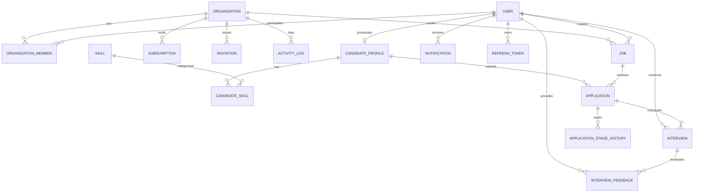

# HireFlow Database Schema Documentation

HireFlow uses **PostgreSQL** managed with **Prisma ORM**. The database is normalized to 3NF with foreign keys, composite indexes, cascading constraints, and multi-tenant data isolation.

---

## 1. Relational Entity Relationship Diagram

---

## 2. Models Detail

### 1. `User`
Stores system accounts across all roles (Super Admin, Recruiter, Hiring Manager, Candidate).
- `id` (UUID, Primary Key)
- `name` (String)
- `email` (String, Unique, Indexed)
- `passwordHash` (String, bcrypt/argon2 hash)
- `phone` (String, Optional)
- `avatar` (String, Optional)
- `role` (Enum `UserRole`: `SUPER_ADMIN`, `RECRUITER`, `HIRING_MANAGER`, `CANDIDATE`)
- `isVerified` (Boolean, default: false)
- `isActive` (Boolean, default: true)
- `lastLoginAt` (DateTime, Nullable)
- `createdAt` / `updatedAt` (DateTime)

### 2. `Organization`
Represents an employer / SaaS tenant entity.
- `id` (UUID, Primary Key)
- `name` (String)
- `slug` (String, Unique, Indexed)
- `description` (Text, Optional)
- `website` (String, Optional)
- `industry` (String, Optional)
- `companySize` (String, Optional)
- `logo` (String, Optional)
- `location` (String, Optional)
- `status` (Enum `OrgStatus`: `ACTIVE`, `SUSPENDED`, `PENDING`)
- `createdAt` / `updatedAt` (DateTime)

### 3. `OrganizationMember`
Links Users to Organizations with role-based permissions.
- `id` (UUID, Primary Key)
- `organizationId` (UUID, Foreign Key -> `Organization.id`)
- `userId` (UUID, Foreign Key -> `User.id`)
- `organizationRole` (Enum `OrgRole`: `OWNER`, `ADMIN`, `MEMBER`)
- `invitationStatus` (Enum `InvitationStatus`: `PENDING`, `ACCEPTED`, `EXPIRED`, `REVOKED`)
- `joinedAt` (DateTime)
- **Constraint**: `@@unique([organizationId, userId])`

### 4. `CandidateProfile`
Specialized profile data for applicants.
- `id` (UUID, Primary Key)
- `userId` (UUID, Unique, Foreign Key -> `User.id`)
- `headline` (String, Optional)
- `summary` (Text, Optional)
- `location` (String, Optional)
- `experienceYears` (Integer)
- `currentCompany` (String, Optional)
- `currentPosition` (String, Optional)
- `expectedSalary` (Decimal 12,2, Optional)
- `noticePeriod` (String, Optional)
- `resumeUrl` (String, Optional)
- `portfolioUrl`, `linkedinUrl`, `githubUrl` (String, Optional)

### 5. `Skill` & `CandidateSkill`
Taxonomy of developer and business competencies.
- `Skill`: `id`, `name` (Unique)
- `CandidateSkill`: `candidateId`, `skillId`, `proficiency` (Beginner / Intermediate / Expert)
- **Constraint**: `@@unique([candidateId, skillId])`

### 6. `Job`
Requisition opening created by recruiters.
- `id` (UUID, Primary Key)
- `organizationId` (UUID, Foreign Key -> `Organization.id`)
- `createdBy` (UUID, Foreign Key -> `User.id`)
- `title`, `slug` (String)
- `description`, `requirements`, `responsibilities` (Text)
- `employmentType` (Enum: `FULL_TIME`, `PART_TIME`, `CONTRACT`, `INTERNSHIP`)
- `workplaceType` (Enum: `ON_SITE`, `HYBRID`, `REMOTE`)
- `experienceMin`, `experienceMax` (Integer)
- `salaryMin`, `salaryMax` (Decimal 12,2)
- `location`, `department`, `openings`
- `status` (Enum: `DRAFT`, `PUBLISHED`, `CLOSED`, `ARCHIVED`)
- `publishedAt`, `applicationDeadline`
- **Constraint**: `@@unique([organizationId, slug])`

### 7. `Application`
Direct candidate submission to a job opening.
- `id` (UUID, Primary Key)
- `jobId` (UUID, Foreign Key -> `Job.id`)
- `candidateId` (UUID, Foreign Key -> `CandidateProfile.id`)
- `resumeUrl` (String)
- `coverLetter` (Text, Optional)
- `status` (Enum `ApplicationStage`: `APPLIED`, `SCREENING`, `SHORTLISTED`, `INTERVIEW`, `ASSESSMENT`, `OFFERED`, `HIRED`, `REJECTED`)
- `source` (String, default: "CAREERS_PAGE")
- `appliedAt`, `updatedAt` (DateTime)
- **Constraint**: `@@unique([jobId, candidateId])` (Prevents duplicate applications to the same job)

### 8. `ApplicationStageHistory`
Audit record of every movement in the ATS Kanban pipeline.
- `id` (UUID, Primary Key)
- `applicationId` (UUID, Foreign Key -> `Application.id`)
- `previousStage` (Enum `ApplicationStage`, Nullable)
- `newStage` (Enum `ApplicationStage`)
- `changedBy` (UUID, Foreign Key -> `User.id`, Nullable)
- `notes` (Text, Optional internal evaluator notes)
- `createdAt` (DateTime)

### 9. `Interview`
Scheduled interview session between candidate and team members.
- `id` (UUID, Primary Key)
- `applicationId` (UUID, Foreign Key -> `Application.id`)
- `interviewerId` (UUID, Foreign Key -> `User.id`)
- `scheduledAt` (DateTime, Indexed)
- `duration` (Integer, minutes)
- `interviewType` (Enum: `TECHNICAL`, `BEHAVIORAL`, `HR`, `FINAL`, `CULTURE_FIT`)
- `meetingLink` (String, Google Meet / Zoom URL)
- `location` (String, Optional)
- `status` (Enum: `SCHEDULED`, `COMPLETED`, `CANCELLED`, `RESCHEDULED`)
- `notes` (Text, Optional)

### 10. `InterviewFeedback`
Post-interview structured scorecard and recommendations.
- `id` (UUID, Primary Key)
- `interviewId` (UUID, Foreign Key -> `Interview.id`)
- `interviewerId` (UUID, Foreign Key -> `User.id`)
- `rating` (Integer, 1 to 5)
- `technicalSkills`, `communicationSkills` (Integer 1-5, Optional)
- `strengths`, `weaknesses` (Text, Optional)
- `comments` (Text)
- `recommendation` (Enum: `STRONG_HIRE`, `HIRE`, `NEUTRAL`, `NO_HIRE`, `STRONG_NO_HIRE`)

### 11. `Notification`
In-app persistent notifications with real-time WebSocket dispatch.
- `id` (UUID, Primary Key)
- `userId` (UUID, Foreign Key -> `User.id`, Indexed)
- `title`, `message`, `type`, `isRead`, `relatedEntityId`, `createdAt`

### 12. Security & Token Models
- `RefreshToken`: `tokenHash` (SHA-256), `expiresAt`, `revokedAt` (Rotating tokens)
- `PasswordResetToken`: `tokenHash`, `expiresAt`, `usedAt`
- `Invitation`: `email`, `role`, `tokenHash`, `expiresAt`, `acceptedAt`
- `ActivityLog`: `action`, `entityType`, `entityId`, `metadata` (JSONB), `ipAddress`
- `Subscription`: `plan` (`STARTER`, `GROWTH`, `ENTERPRISE`), `status`, `expiresAt`
- `SystemSetting`: `key` (Unique), `value` (Text)

